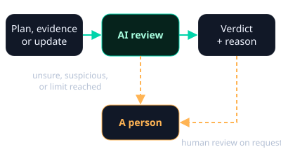
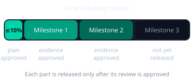
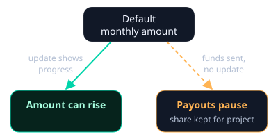

# How accountability works

Part of every trading fee goes to a project or a cause (see
[Fees](fees.md)). This page explains how that money is tied to progress:
milestone releases for **idea coins**, and continued funding for **Giveth
projects**.

## How reviews work

AI reviews plans, evidence and project updates, decides, and gives a short
reason. This keeps reviews to minutes, not days. Larger amounts get a more
thorough AI review.

A person steps in when the AI is unsure, when something looks like fraud or
an attempt to steer the review, or when automatic approvals reach a set
limit.

## Lenient at launch

Standards are still being set, so reviews are easygoing for now. They don't
judge ambition, polish or small gaps. But **some evidence of progress** is
required: a link to working code, a release, a demo, a receipt or a public
post, not just "we're building it". Clear fraud, such as fabricated or
recycled proof, is rejected.

## Idea coins: funds released by milestone

An idea coin's share is released in steps, not all at once.

1. **Plan.** The recipient files a public plan of milestones, each with a
   deliverable, the evidence to be shown, a deadline and an amount. Plans
   are approved unless clearly abusive or a milestone has nothing anyone
   could check. Otherwise the reviewer says what to fix.
2. **Small start.** An approved plan can release up to 10% of the round.
   Nothing is released before that.
3. **Evidence.** The recipient submits public evidence for each milestone.
4. **Verdict.** The reviewer approves, requests changes or rejects, with a
   reason. Approval releases that milestone's amount.
5. **Payout.** Approved amounts are paid in batches (expected every 1-7 days).

**Missed deadlines.** A missed deadline gets one 30-day grace period. If
it's missed again, or no plan is approved within 90 days, unreleased funds
can move to the community takeover.

## Giveth projects: funding follows progress

- Each project starts with a **default monthly amount**.
- A public Giveth update that says what the funds paid for, and what comes
  next, can **raise** the monthly amount.
- If funds were sent and no update shows progress, payouts can **pause**
  until one does. The share stays set aside for that project.

The same lenient standard applies, and a person can override any decision.

## What we plan to do

These are intentions, without dates, and they may change.

- Faster payouts.
- Clearer standards based on what can be verified, with stricter reviews
  over time.
- Ways for others to challenge decisions, and richer appeals.
- Decentralized dispute resolution.

## Related

- [Fees](fees.md): who gets which part of each trading fee.
- [Support](support.md)
