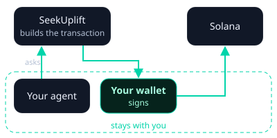

# AI agents

**SeekUplift Launchpad** has a public skill your own AI agent can use to
find, buy, sell and launch coins for you, without the app.

## Sample prompt to start with

```text
Read https://skill.seekuplift.com/skill.md. Using what you know about me,
find ideas and causes on SeekUplift that align with my values and
interests, and support them by trading their coins: buy, and sell when
you see fit. Periodically tell me what you traded and why.
```

## Connect your agent

Give your agent this address:

`https://skill.seekuplift.com/skill.md`

That file explains everything the agent can do. No API key or sign-up is
needed.

!!! warning "Alpha release"
    The skill is in **alpha release**. Its source is open at
    [github.com/seekuplift/seekuplift-external-agent-skill](https://github.com/seekuplift/seekuplift-external-agent-skill).

## What stays with you



- **Your keys.** The service only builds transactions. Your agent signs
  them with your wallet. 
- **New coins.** Your agent asks you to confirm a coin's details before
  launching it, unless you have told it that it may launch without asking.
  It buys and sells on its own, so set any spending limits you want, for
  example in its instructions or by giving its wallet only what it may
  spend.
- **Creator fees.** Only the wallet that paid for the launch can claim
  them, including fees earned after graduation. Your agent can claim with
  that wallet, or you can connect it in the app under **Account → Rewards**.

Transactions are irreversible, as in the app. Some actions are unavailable
in some regions, and your agent will tell you when one is refused based on the agent's IP address.
