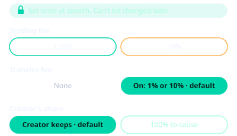
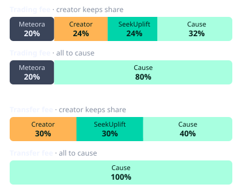

# Fees

At launch, the creator customizes a coin's fees across three permanent choices:

- **Trading fee**: **1.25%** or **10%** of every trade, paid in SKR. The rate is exactly 1.25% or 10% once the launch window ends (see [Launch window](#launch-window)), and stays there after graduation.[^rounding]
- **Transfer fee**: **None**, or **1%** (on the 1.25% tier) / **10%** (on the 10% tier) of every token transfer, paid in the coin.
- **Creator fee to the cause** (meme coins): **0%** (default — creator keeps their share) or **100%** (creator gives their share and SeekUplift gives its share to the cause).

More values will be added for better customization.

## Trading fee split

Meteora takes **20%** of every trading fee first. The remaining **80%** splits the same way on the bonding curve and after graduation.[^rounding]

The SeekUplift and cause shares are held on-chain through the SeekUplift fee-router program (`58WD4EKiGi85vxNKC9ox6courGSvKK2L2X3g3NZSR3Hh`) until paid out.

### Standard (creator keeps their share)

Of the 80% left after Meteora, the creator gets 30%, SeekUplift 30%, and the project or cause 40%.

| Config | Trading fee | Meteora | Creator | SeekUplift | Project or cause |
|---|---|---|---|---|---|
| 1.25% standard (with or without 1% transfer fee) | **1.25%** | 0.25% | 0.30% | 0.30% | 0.40% |
| 10% standard (with or without 10% transfer fee) | **10%** | 2.00% | 2.40% | 2.40% | 3.20% |

### All to the cause (100% creator fee to cause)

The creator and SeekUplift take **0%**. Everything left after Meteora goes to the cause.

| Config | Trading fee | Meteora | Creator | SeekUplift | Cause |
|---|---|---|---|---|---|
| 1.25% all-to-cause (with or without 1% transfer fee) | **1.25%** | 0.25% | 0% | 0% | 1.00% |
| 10% all-to-cause (with or without 10% transfer fee) | **10%** | 2.00% | 0% | 0% | 8.00% |

!!! note "Sending 100% of the fee to the cause"
    For coins with no creator or launchpad fee, we may work to distribute the full **100%** of trading fees to the cause (instead of 80% after Meteora's 20% protocol cut) by possibly forking Meteora DBC, as allowed by its license for non-commercial use.

## Launch window

To deter snipers, every coin opens with a very high trading fee (about 99%) that falls in 20 steps over about 10 minutes to exactly **1.25%** or **10%**, depending on the tier you chose, and stays there. The same rate applies after graduation.

## Fee-on-transfer coins

The **transfer fee** (**1%** with the 1.25% trading fee, **10%** with the 10% one) is on by default for meme and idea coins. It is charged in the coin itself on every buy, sell and send, on any venue, before and after graduation. Quotes in the app already show amounts after the fee. Meteora takes no cut.[^rounding]

| Config | Transfer fee | Creator | SeekUplift | Project or cause |
|---|---|---|---|---|
| 1.25% trading + 1% transfer (standard) | **1%** | 0.30% | 0.30% | 0.40% |
| 10% trading + 10% transfer (standard) | **10%** | 3.00% | 3.00% | 4.00% |
| 1.25% trading + 1% transfer (all-to-cause) | **1%** | 0% | 0% | 1.00% |
| 10% trading + 10% transfer (all-to-cause) | **10%** | 0% | 0% | 10.00% |

Creators collect their share in the app.

## What happens at graduation

When the curve fills, Meteora moves the coin to a DAMM v2 pool.

| Item | What applies |
|---|---|
| Migration fee | 0% from SeekUplift and the creator; 0.2% Meteora protocol migration fee |
| Pool trading fee | Exactly 1.25% or 10% (20% to Meteora, 80% split as above) |
| Liquidity | Permanently locked (70% fee-router claim account / 30% creator on standard configs; 100% fee-router claim account on all-to-cause configs) |

## Other fees
- **0.01 SOL launch fee** to create a coin (SeekUplift receives 0.009 SOL, Meteora 0.001 SOL). The launch also pays about **0.0108 SOL** of rent and network fee for the coin's accounts (about **0.0093 SOL** without a creator first buy), so a launch costs about **0.0208 SOL** in total (measured: 0.020837 SOL with a first buy and the transfer fee).
- 10 SKR to create an in-app wallet.
- SOL network gas is separate.
- Fees to appeal decisions on whether funding to ideas or causes should be released. Creator fees are no-strings-attached and instantly claimable.

[^rounding]: Fees and fee shares are calculated on-chain in whole token units (the smallest unit of SKR or of the coin), so the amount charged or received on a given trade or transfer can differ slightly from the stated percentage because of rounding, most noticeably on very small amounts. The percentages on this page may themselves be rounded. The amount the smart contract charges controls; see the [Terms](terms.md) (sections 6.1 and 12.2).
